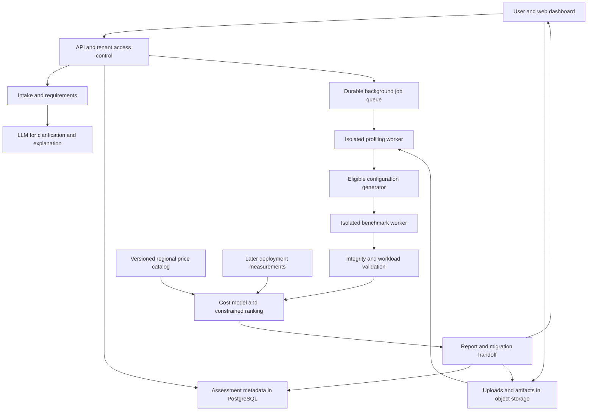

# Data Optimizer architecture reference

Local reference captured on 2026-11-01 from [Data Optimizer Architecture and Engineering Handoff](https://chatgpt.com/space/page_70c9d50022408191ac909c4788104be7).

**Implementation authority:** read `../SPRINT_HANDOFF.md` first. It defines the current sprint order, decisions, acceptance gates and execution status. The earlier week-based roadmap below is historical planning context; it does not override the executable sprint plan. This local copy lets future chats work without access to Pages. Do not maintain sprint status in this snapshot or require Page access to begin work.

Build Data Optimizer as a workload aware storage advisor. It should turn a startup description, representative data and access requirements into tested storage configurations, an explanation of tradeoffs, a migration plan and a savings estimate.

The strongest initial product is an advisor for startup analytics and event datasets. Start with CSV, newline delimited JSON and Parquet uploads. Benchmark a small set of lossless representations against the same workload. Expand into database and cloud account analysis after this flow is dependable.

Planning assumption: two developers with part time data engineering support, an eight week MVP, one cloud pricing catalog and no production migration automation. These are scope choices to validate during discovery.

# Product scope and users

The primary user is a technical founder, backend engineer or small data team that has growing analytics exports, event logs or historical records. They need to decide whether a change is worthwhile and how to apply it safely.

The product answers five connected questions:

1. What data do you have, and how is it used?

2. Which representation and storage arrangement fits those requirements?

3. What did we measure, and what remains an assumption?

4. How much physical space and total cost could change?

5. What would implementation, verification and rollback require?

For an early startup without existing data, offer a design consultation with explicit volume and usage scenarios. Historical savings are unavailable until a baseline exists. For an existing dataset, offer a benchmark backed assessment. For an installed customer, later compare observed outcomes with a workload adjusted baseline.

Optimize per dataset and workload. A startup may need a transactional database for orders, object storage for attachments and a separate analytical representation for event history. A single company wide storage winner would conceal these different requirements.

The MVP supports one analytical workload family and bounded upload sizes, initially targeting 100 MB to 1 GB per assessment subject to profiling on the chosen worker hardware. Larger inputs use representative samples and are labeled accordingly. Production database replacements, arbitrary cloud migrations, media optimization, vector databases and automatic deletion are later work.

# User workflow

1. **Describe the business.** Ask what the product does and which data is causing a storage or cost problem.

2. **Confirm requirements.** Capture dataset types, current system, stored size, daily growth, read and write rates, common queries, concurrency, freshness, retention, maximum acceptable latency, recoverability, region and budget. Distinguish unknown values from zero. Ask only the missing questions that can change the decision.

3. **Provide evidence.** Upload a file or a local profiler report, along with representative queries or query templates. Metadata only mode offers preliminary guidance with lower evidence coverage. Raw customer records need not be sent to the language model.

4. **Profile and establish the baseline.** Record the original representation, measured bytes, schema, workload and environment. Identify repeated values, nulls, distinct counts, data types, temporal distribution and object size distribution. Repeated records are observations, not permission to remove them.

5. **Construct eligible alternatives.** Retain the current configuration as a candidate. Generate supported combinations of format, compression and layout. Exclude options that violate required semantics or capabilities.

6. **Run bounded experiments.** Convert copies, verify integrity, replay the workload and record storage, performance and resource use.

7. **Compare outcomes.** Show the lowest estimated cost option that meets requirements, a faster alternative where relevant and the current setup. Explain the evidence and assumptions behind each.

8. **Generate the engineering handoff.** Export configurations, transformation scripts, validation checks, expected costs, dependencies and rollback steps.

9. **Track adoption and outcomes.** Let the user mark an action as planned or deployed. Later, collect storage and billing observations and show realized results separately from projections.

Suggested screens: project intake, dataset and workload upload, assessment progress, comparison report, implementation handoff and savings history. Progress should expose useful states such as profiling, testing 4 of 12 candidates and preparing results. Missing requirements, incompatible schemas, budget exhaustion and no beneficial change are normal outcomes.

# System architecture



Use one backend codebase with separate API and worker processes. The API handles authentication, assessment state and short requests. Workers handle parsing, conversion, profiling and queries. Benchmark jobs need explicit CPU, memory, disk, time and monetary limits.

The metadata database stores evidence references and results. Object storage holds encrypted uploads, transformed copies and reports with expiration policies. The language model receives an approved structured summary, not credentials or unrestricted access to the workers.

| Component | Proposed MVP choice | Purpose |
| --- | --- | --- |
| Web dashboard | React with TypeScript | Intake, progress, comparisons and handoff |
| API | Python FastAPI with typed request validation | Assessment orchestration and access checks |
| Analysis | DuckDB and PyArrow | Profile files, convert representations and execute analytical workloads |
| Metadata | PostgreSQL | Projects, requirements, jobs, results and audit events |
| Background work | Redis with RQ workers | Asynchronous analysis with bounded retries |
| Data and reports | S3 compatible object storage | Separate large artifacts from metadata |
| Deployment | Containers for API and workers | Reproducible execution and resource controls |
| Search | Explicit candidate enumeration first; Optuna later | Spend experiments on promising configurations |
| Language model | Structured intake and grounded explanations | Improve usability without inventing benchmark results |

These are proposed engineering choices, not measured winners. Keep versions pinned and record them with every experiment. Host the worker near the data when using a real cloud backend. Local disk timings must be identified as local measurements rather than cloud performance predictions.

Parquet is a column oriented format with compression and encoding support. That makes it a useful candidate for analytical data, with compatibility still needing verification in the intended reader. [Apache Parquet overview](https://parquet.apache.org/docs/overview/)

# Recommendation method

A recommendation should depend on the dataset and workload measured during the assessment. Hard requirements establish eligibility; measurements determine which eligible option is preferable.

Represent a candidate as:

```text
configuration = {
  data_representation,
  compression_codec_and_level,
  file_size_target,
  row_group_size,
  partition_columns,
  sort_columns,
  storage_backend_and_tier
}
```

The MVP varies representation, codec and a small number of layout choices on a fixed analytical engine. Candidate examples include the original input, gzip compressed NDJSON, Parquet with Snappy and Parquet with Zstandard. Test bounded row group and partition alternatives when workload evidence supports them. Gzip compressed NDJSON may offer a storage benefit while increasing scan cost; the report must show both.

Partitioning only helps relevant access patterns and can create excessive small files. Test a limited set, including no partitioning. Keep type changes lossless for the supported dataset semantics. For NDJSON, explicitly define whether preserving record meaning is sufficient or the original byte representation is required.

The optimization objective is:

```text
minimize expected total cost over the selected horizon

subject to:
  data integrity and required semantics preserved
  observed latency and throughput meet the workload target
  freshness and update capabilities are compatible
  retention and required recovery properties are preserved
  migration cost and experiment budget fit the user's limits
```

Show the cost and latency tradeoff among candidates where no single candidate is better on both. Call this the best tested feasible option within the supported search space. Retain the current setup when no change has a worthwhile net benefit. Abstain when workload or integrity evidence is insufficient.

A language model helps extract requirements, suggest clarifying questions and explain results. Structured validators check all generated fields. The model does not calculate the authoritative savings, choose unsupported configurations or execute generated shell commands.

For a small search space, directly test eligible candidates. For a larger one, use sequential optimization: propose a configuration, measure it, update the search and repeat until the trial or cost budget is reached. Optuna supports optimization of multiple objectives and analysis of tradeoff candidates. [Optuna multi objective optimization](https://optuna.readthedocs.io/en/stable/tutorial/20_recipes/002_multi_objective.html)

After collecting enough diverse experiments, train predictive models for compressed bytes, latency and resource use. Features can include type distributions, distinct value ratios, null density, row width, file count, query selectivity, concurrency and candidate parameters. Benchmark measurements supply the labels. Keep customer data private; cross customer training requires explicit permission.

Evaluate learned models on held out datasets or customers and later time periods, not random rows from the same dataset. Compare prediction error, constraint violations and decision regret against direct search and the current setup. Use predictions to prioritize experiments, then verify the selected candidate. There is no need for a large custom model in the first version.

# Benchmark design and evidence

Start by agreeing on the logical dataset and supported operations. All comparisons must preserve that scope. A historical analytical copy is not a drop in replacement for an application database with transactions and updates.

Use representative samples across time periods, schema variants and data sources. Compare multiple sample sizes and hold back a separate slice for validation. Never rely only on the first rows of a sorted file. Report the sampled fraction and which workload classes were exercised. Do not extrapolate production concurrency or full dataset performance from an unvalidated sample.

For each candidate, record output bytes, metadata overhead, conversion time, peak memory, CPU time, query latency, bytes read where measurable, failures and integrity status. Keep timeouts as failed or censored trials rather than treating them as fast results.

Replay an agreed workload mix such as time range filters, grouped aggregates, projections and occasional full scans. Run repeated warm and cold cache experiments with a documented cache procedure and identical resource limits. Report median and tail latency only when the request count supports them; otherwise show observed timings and explicitly mark tail latency as unvalidated.

DuckDB can apply projection and filter pushdown when reading Parquet, allowing some queries to read fewer columns or skip parts of the data. This is a reason to test real query patterns rather than file size alone. [DuckDB Parquet documentation](https://duckdb.org/docs/stable/data/parquet/overview)

Validate row counts, schema mappings, nulls, decimal precision, identifiers, timestamps and representative query results. Compare canonicalized row content with multiplicity preserved; a raw file hash cannot prove equality across different encodings. Define allowed floating point tolerances explicitly. Validate order only where the workload requires it. Retain original copies and never infer that duplicate looking business events are expendable.

Record environment, engine and codec versions, input fingerprint, random seed, sample method, workload fingerprint, resource limits and repeat counts. A report should be reproducible from these records and artifact references.

Separate three kinds of result: measured on the uploaded sample, projected for a specified larger workload and observed after deployment. Evidence coverage should include bytes tested, time periods, query categories and excluded capabilities. Confidence should reflect repeated measurement and coverage; do not display an invented model certainty percentage.

# Savings calculation

Space and money measure different outcomes. Fewer stored bytes can leave a provisioned database bill unchanged until capacity can actually be reduced. Moving data to an archive can reduce the bill without reducing bytes.

For equivalent logical content and retention:

```text
physical_space_saved = baseline_physical_bytes - candidate_physical_bytes
space_saved_percent = 100 * physical_space_saved / baseline_physical_bytes
```

Use explicit units and account for all copies, indexes, metadata and backups inside the comparison boundary. Report migration peak space separately because both copies may exist temporarily.

Estimate monthly operating cost as:

```text
storage capacity
+ query and transformation compute
+ read and write requests
+ retrieval and network transfer
+ replicas and backups
+ monitoring and scheduled maintenance
+ recurring service and optimization fees
```

Only count a shared provisioned resource reduction when a corresponding capacity change is achievable. Separate marginal costs from unavoidable fixed commitments. Use the same region, currency, volume, access mix, retention and availability requirements for both alternatives. Include current contract discounts where known.

Cloud storage bills contain charges beyond bytes stored, and storage classes can have minimum billable sizes and retention durations. The price catalog therefore needs regional rates, effective dates, billing units, request charges and minimums. [Amazon S3 pricing](https://aws.amazon.com/s3/pricing/)

Store the price snapshot used for each assessment. If prices or workload rates are missing, show formulas and scenario ranges rather than precise savings.

```text
monthly_recurring_savings = baseline_monthly_cost - candidate_monthly_cost
horizon_net_savings = sum(monthly_recurring_savings_over_horizon) - migration_cost
payback_months = migration_cost / monthly_recurring_savings
```

The payback formula applies only to positive, approximately steady monthly savings. Migration cost includes transformation work, temporary duplicate storage, network transfer, implementation labor and rollback preparation. Avoid subtracting the same charge twice.

Illustrative arithmetic only, using invented monthly cost totals rather than provider quotes:

| Item | Baseline | Candidate |
| --- | --- | --- |
| Physical storage for the same retained data | 1,000 GB | 350 GB |
| Monthly storage charge | $100 | $35 |
| Query compute | $180 | $120 |
| Requests, transfer and maintenance | $20 | $25 |
| Monthly total | $300 | $180 |

This scenario saves 650 GB or 65% of physical storage and $120 or 40% of recurring monthly cost. With $300 in one time migration cost, payback is 2.5 months and twelve month net savings are $1,140, assuming steady costs and volumes. The first month has negative net savings after migration.

Projected savings use modeled inputs. Realized savings use post deployment measurements compared with a defensible estimate of what the baseline would have cost under the same volume and usage. Show actual invoices alongside the adjustment method; a quieter month alone is not evidence that the optimization worked.

# Data model and API contracts

Keep the assessment as an immutable requirements snapshot plus versioned experiments and results.

| Entity | Essential fields |
| --- | --- |
| Project | tenant, owner, business context, region |
| Dataset | source reference, input fingerprint, size, schema, sensitivity |
| Requirements | workload version, latency, freshness, retention, capabilities, unknown fields |
| Assessment | dataset version, requirements snapshot, budget, lifecycle state |
| Profile | sample method, sampled bytes, feature statistics, coverage |
| Candidate | full configuration, eligibility evidence, configuration hash |
| Experiment | candidate, environment, repeats, metrics, integrity result, artifacts |
| PriceSnapshot | provider, region, currency, effective date, units, rates |
| Recommendation | selected experiment, alternatives, assumptions, cost breakdown |
| MigrationPlan | versioned steps, validation, rollback, deployment status |
| Observation | period, actual bytes, usage, costs, adjusted baseline |
| AuditEvent | actor, action, resource, time |

Every object access must be scoped to its tenant. Store secrets in a secret manager, not report fields.

Proposed API operations:

```text
POST /v1/projects
POST /v1/projects/{project_id}/datasets
POST /v1/assessments
GET  /v1/assessments/{assessment_id}
GET  /v1/assessments/{assessment_id}/recommendations
GET  /v1/assessments/{assessment_id}/handoff
POST /v1/assessments/{assessment_id}/cancel
POST /v1/migration-plans/{plan_id}/observations
```

Return HTTP 202 and an assessment ID for asynchronous runs. Use idempotency keys on assessment creation. Persist job state and attempt counts so retries do not duplicate expensive experiments.

Assessment states: draft, needs_input, queued, profiling, benchmarking, scoring, completed, failed and cancelled. Completed assessments include a recommendation outcome of change, keep_current or insufficient_evidence. Budget exhaustion can produce a partial report with explicit coverage, rather than pretending the search completed.

Example recommendation contract:

```json
{
  "outcome": "change",
  "evidence_level": "sample_benchmarked",
  "candidate_id": "candidate_04",
  "configuration": {
    "format": "parquet",
    "codec": "zstd",
    "partition_by": []
  },
  "experiment_ids": ["experiment_12"],
  "integrity_status": "passed",
  "performance_scope": "sample_on_recorded_worker_environment",
  "price_snapshot_id": "prices_region_date",
  "estimated_savings": {
    "currency": "USD",
    "horizon_months": 12,
    "monthly_net": 120,
    "one_time_migration": 300,
    "horizon_net": 1140
  },
  "limitations": [
    "Full dataset concurrency has not been validated"
  ],
  "migration_plan_id": "plan_03"
}
```

The savings values illustrate the arithmetic example above. Production responses must carry input provenance and calculation details, with unavailable values represented as null rather than invented numbers.

# Privacy and operational boundaries

Default to read only analysis of copies. Use encrypted storage, tenant scoped authorization, short lived upload links and an explicit raw data expiration policy. Show the retention choice before upload and provide deletion controls.

Provide a local profiler mode for sensitive datasets. This produces schema statistics and workload summaries without transferring raw records. Explain that statistics and query text can themselves expose sensitive information and let users review the report before upload.

Run parsing and benchmarks in isolated workers with bounded CPU, memory, disk, execution time and decompression limits. Restrict network access, extensions, filesystem paths and query operations. Accept a constrained workload description or validated read only queries against the assessment dataset, rather than arbitrary executable code.

Treat file contents and query comments as data, including any text that looks like instructions to the language model. Exclude secrets and raw records from logs. Prefer summarized metadata for explanations.

Retry transient failures with capped backoff. Honor cancellation and remove expired temporary artifacts. Record quota use so one tenant cannot exhaust all workers. Track queue age, job failures, analysis cost, worker resource use and report generation failures.

Production deployment remains a separate, explicit customer action. Later automation should create a copy, validate it, run a canary workload, switch readers deliberately, monitor and support rollback. Retention changes, lossy transformations and record deletion require separate business authorization.

# Implementation roadmap

The schedule assumes two developers and a bounded analytical scope. Use acceptance gates to adjust dates when benchmark reliability or data compatibility needs more work.

| Period | Deliverable | Acceptance gate |
| --- | --- | --- |
| Week 1 | Discovery, product contract and benchmark fixtures | Interview 5 to 8 prospective users; agree on target data, comparison boundary and 3 to 5 workloads |
| Weeks 2 and 3 | Upload, typed parsing, profiling and baseline | Supported files produce repeatable profiles; malformed inputs fail cleanly; semantic edge cases preserve meaning |
| Week 4 | Conversion and benchmark worker | Baseline plus at least 3 alternatives run under quotas with integrity evidence and recorded environments |
| Week 5 | Cost calculator and ranking | Costs reconcile with line items; constraints reject incompatible candidates; keep_current and missing input paths work |
| Week 6 | Dashboard, explanations and handoff export | A user can submit evidence and retrieve an understandable report linked to measured results |
| Week 7 | Evaluation and pilot fixes | Evaluate held out fixtures; verify isolation, cleanup, restart and cancellation; investigate prediction errors |
| Week 8 | Pilot and release decision | Pilot users can reproduce one recommendation and assess its migration economics; unresolved gaps are documented |

Suggested ownership: the backend developer owns intake contracts, metadata, queue and access controls; the data engineer owns profiling, conversions, experiments and cost calculations; the frontend developer owns the assessment flow and evidence presentation. In a two person team, combine frontend and API work and allocate explicit review time for data correctness.

Prioritized implementation backlog:

1. Define the supported dataset semantics, requirement schema and result contract.

2. Create representative event fixtures, high cardinality text fixtures, already compressed inputs and timestamp or precision edge cases.

3. Implement the standalone profiling and conversion pipeline before the dashboard.

4. Build integrity verification and repeatable benchmark capture.

5. Implement candidate comparison, price snapshots and itemized savings calculations.

6. Add asynchronous assessment state, API access checks and resource quotas.

7. Add the dashboard and grounded explanations.

8. Generate migration scripts, validation instructions and rollback plans.

9. Validate with pilot datasets and add local profiling for users who cannot upload records.

The first demonstrable milestone is a command line assessment: input file plus workload and requirements produces a baseline, three measured alternatives, integrity results and a transparent report. The web product should wrap this dependable core.

# Evaluation and definition of done

The MVP must work for cases with little or no savings. Its quality is the correctness and usefulness of the decision.

Use an evaluation suite spanning repeated categorical events, high cardinality strings, nested records, varying time distributions, tiny files, already optimized Parquet and malformed inputs. Include datasets with legitimate duplicate events. Hold out whole datasets from any learned model.

A release candidate should satisfy these checks:

- Every selected configuration has passed integrity verification for supported semantics.

- Every recommendation satisfies the tested workload requirements within the stated environment and scope.

- Every numeric savings claim links to measurements or labeled assumptions and a versioned cost calculation.

- A dataset that is already efficient can return keep_current.

- Missing access patterns produce clarification or insufficient_evidence.

- Retried jobs do not duplicate completed trials, and cancellation stops remaining work.

- One tenant cannot read another tenant's data, reports or signed upload paths.

- LLM explanations cannot alter stored metrics or trigger execution.

- Handoff steps include validation and rollback, and can be reproduced on a provided fixture.

Track compression ratio, cost estimate error, latency estimate error, rate of constraint violations, assessment runtime and cost, reproducibility and pilot adoption. For learned candidate ranking, also track decision regret against exhaustive testing of a bounded evaluation search space. Set numeric release thresholds after measuring the baseline in Week 1; do not promise universal savings.

Handoff contents for each recommendation: current state, candidate configuration, tested evidence, untouched requirements, assumptions, costs, transformation commands, expected output artifacts, integrity checks, canary checks, migration peak space, reader compatibility, rollback trigger and rollback procedure. Generate the commands from validated templates and versioned parameters.

# Improvements after the MVP

Prioritize improvements according to evidence from pilots:

1. **Workload aware lifecycle suggestions.** Use observed access history to simulate hot, warm and cold placement, with retrieval cost and restore latency included.

2. **Read only connectors and a local profiler.** Import table statistics, storage inventories and billing usage before moving raw data.

3. **Continuous reassessment.** Detect changes in schema, query mix, growth or prices that could change a prior decision. Notify users only when the expected value is material.

4. **Learning from experiments.** Predict useful candidates to reduce assessment cost, while keeping final verification.

5. **Broader system choices.** Add database physical design or analytical database comparisons only with transaction, concurrency, durability and operational cost tests.

6. **Measured migration assistance.** Pilot a copy and canary workflow before introducing direct changes to production.

Differentiate the product through reproducible evidence, explicit uncertainty, private analysis and savings verification. Generic storage advice is easy to generate; a recommendation that an engineer can reproduce and safely implement is the stronger product.

Test willingness to pay with paid assessments or a small recurring subscription after validating the technical result. Customers with tiny datasets may save too little in storage fees to justify an elaborate platform, so report dollar impact and engineering effort early. A savings based fee needs an agreed baseline and attribution method before it is credible.

